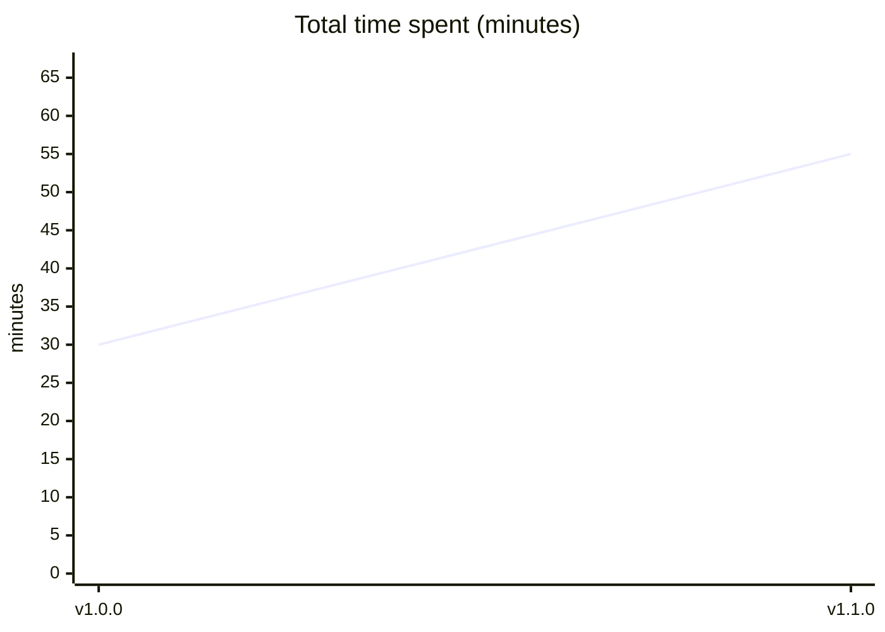

# CHANGELOG — landing-page

<!-- PROJECT-STATS:START (auto-updated by GitHub, don't edit by hand) -->
## Project growth
**2** versions · **55** min (~0.9 h) spent · **573** lines of code now



```mermaid
xychart-beta
    title "Lines of code"
    x-axis ["v1.0.0", "v1.1.0"]
    y-axis "lines" 0 --> 688
    line [490, 573]
```
<!-- PROJECT-STATS:END -->

Newest first. Never delete or rewrite old entries.

| Version | Date | Time | Summary |
|---|---|---|---|
| [**v1.1.1**](#v111--2026-11-25-time-spent-3-min) | 2026-11-25 | 3 min | 😎 Greeting uses my nickname |
| [**v1.1.0**](#v110--2026-11-25-time-spent-25-min) | 2026-11-25 | 25 min | 🕐 City drop-down on each clock; weather retries; growth charts |
| [**v1.0.0**](#v100--2026-11-25-time-spent-30-min) | 2026-11-25 | 30 min | 🏠 First version: search, clocks, weather (today + 7 days), to-do, links |

## v1.1.1 — 2026-11-25 (time spent: ~3 min)
- **What changed:** The greeting at the top now says "Good evening, Atsuwwatti Escobar Nishiburton" (my nickname), set in `js/config.js`.
- **Why:** It's my page, so it should greet me by my nickname.

## v1.1.0 — 2026-11-25 (time spent: ~25 min)
- **What changed:**
  - 🕐 Each clock now has a **city drop-down** (21 cities, from Honolulu to Auckland). The defaults stay San Carlos, New York, London, Tokyo, and each pick is remembered in the browser.
  - 🌤️ Weather now **tries 3 times** when the connection drops, then tries again by itself every minute. Meanwhile it shows the last saved weather instead of an error.
  - 📈 New **Project growth** line charts at the top of this file (total time spent, lines of code), redrawn by a free GitHub robot (`scripts/changelog_stats.py` + `.github/workflows/changelog-stats.yml`).
- **Why:** I want to switch clock cities when needed. On launch day the weather got stuck on "Loading…" because the connection to Open-Meteo was being cut off (`ERR_CONNECTION_RESET`) for a few minutes. Also: `index.html` now loads files with `?v=1.1.0`, so browsers pick up new versions right away instead of a saved old copy. And I want to see the project grow, like my agent repo's charts.

## v1.0.0 — 2026-11-25 (time spent: ~30 min)
- **What changed:** First version of my start page, with a dark AtsuMail-style theme:
  Google search; 4 world clocks (San Carlos, New York, London, Tokyo) with day/night and "tomorrow"; weather for 5 cities in one call with a **Today / 7 days** switch, rain chance at 30% or more, and add/remove cities; to-do list saved in the browser; project and quick-link buttons. Works on PC (Chrome and Edge) and phone.
  Tested in a simulated browser with sample weather: 20 checks passed (views, add/remove city, to-dos, safe text).
- **Why:** I want my own landing page instead of a plain Google page: my repos, weather comparison, world time and to-dos in one place.
