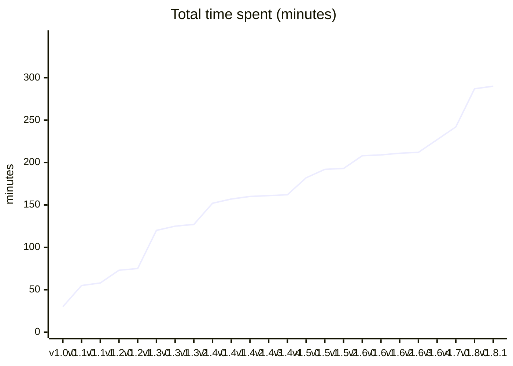
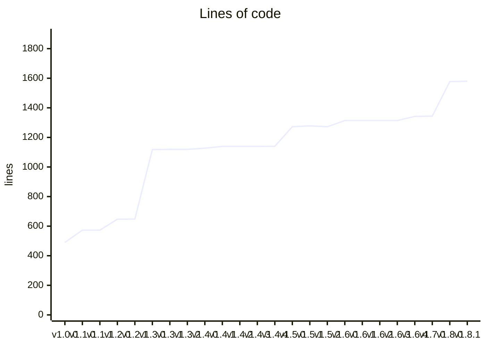

# CHANGELOG — landing-page

<!-- PROJECT-STATS:START (auto-updated by GitHub, don't edit by hand) -->
## Project growth
**24** versions · **290** min (~4.8 h) spent · **1,580** lines of code now

<!-- PROJECT-STATS:END -->

Newest first. Never delete or rewrite old entries.

| Version | Date | Time | Summary |
|---|---|---|---|
| [**v1.8.1**](#v181--2026-11-27-time-spent-3-min) | 2026-11-27 | 3 min | 🏷️ Version number next to my name |
| [**v1.8.0**](#v180--2026-11-27-time-spent-45-min) | 2026-11-27 | 45 min | 🔄 To-dos sync between PC and Pixel through Google Tasks |
| [**v1.7.0**](#v170--2026-11-27-time-spent-15-min) | 2026-11-27 | 15 min | 🏠 Real phone icon: installs on the Pixel like an app |
| [**v1.6.4**](#v164--2026-11-27-time-spent-15-min) | 2026-11-27 | 15 min | 🧹 Small fixes: PST/PDT by itself, links in new tabs, `/` for search, one version number |
| [**v1.6.3**](#v163--2026-11-26-time-spent-1-min) | 2026-11-26 | 1 min | 🖤 Weekday letters in black on the yellow row |
| [**v1.6.2**](#v162--2026-11-26-time-spent-2-min) | 2026-11-26 | 2 min | 💛 Weekday row: yellow background, letters back to gray |
| [**v1.6.1**](#v161--2026-11-26-time-spent-1-min) | 2026-11-26 | 1 min | 💛 Calendar weekday row in yellow |
| [**v1.6.0**](#v160--2026-11-25-time-spent-15-min) | 2026-11-25 | 15 min | 🇯🇵 日経 tab: section buttons + Nikkei search |
| [**v1.5.2**](#v152--2026-11-25-time-spent-1-min) | 2026-11-25 | 1 min | ➖ Removed the Nikkei Asia tab |
| [**v1.5.1**](#v151--2026-11-25-time-spent-10-min) | 2026-11-25 | 10 min | 🗞️ Nikkei Asia tab in the News box |
| [**v1.5.0**](#v150--2026-11-25-time-spent-20-min) | 2026-11-25 | 20 min | 📰 News box: Bloomberg headlines by genre |
| [**v1.4.4**](#v144--2026-11-25-time-spent-1-min) | 2026-11-25 | 1 min | 💙 Date under my name in light blue |
| [**v1.4.3**](#v143--2026-11-25-time-spent-1-min) | 2026-11-25 | 1 min | ✏️ Nickname spelling: Atsuwatti |
| [**v1.4.2**](#v142--2026-11-25-time-spent-3-min) | 2026-11-25 | 3 min | 🤏 Smaller, more compact calendar |
| [**v1.4.1**](#v141--2026-11-25-time-spent-5-min) | 2026-11-25 | 5 min | ↔️ Shorter search on the left, calendar on the right |
| [**v1.4.0**](#v140--2026-11-25-time-spent-25-min) | 2026-11-25 | 25 min | 🗓️ Month view with event boxes, like my phone's calendar widget |
| [**v1.3.2**](#v132--2026-11-25-time-spent-2-min) | 2026-11-25 | 2 min | ⬆️ My calendar card moved above the clocks |
| [**v1.3.1**](#v131--2026-11-25-time-spent-5-min) | 2026-11-25 | 5 min | 🔏 Privacy policy page (needed by Google) |
| [**v1.3.0**](#v130--2026-11-25-time-spent-45-min) | 2026-11-25 | 45 min | 📅 My Google Calendar: see, add, change, delete events |
| [**v1.2.1**](#v121--2026-11-25-time-spent-2-min) | 2026-11-25 | 2 min | 📊 Myojin spreadsheet link in My projects |
| [**v1.2.0**](#v120--2026-11-25-time-spent-15-min) | 2026-11-25 | 15 min | 📅 Mini calendar, yellow nickname, seconds on clocks, °F + °C |
| [**v1.1.1**](#v111--2026-11-25-time-spent-3-min) | 2026-11-25 | 3 min | 😎 Greeting uses my nickname |
| [**v1.1.0**](#v110--2026-11-25-time-spent-25-min) | 2026-11-25 | 25 min | 🕐 City drop-down on each clock; weather retries; growth charts |
| [**v1.0.0**](#v100--2026-11-25-time-spent-30-min) | 2026-11-25 | 30 min | 🏠 First version: search, clocks, weather (today + 7 days), to-do, links |

## v1.8.1 — 2026-11-27 (time spent: ~3 min)
- **What changed:** A small grey badge like **v1.8.1** now shows right after my name in the greeting at the top. It reads the number from `js/config.js`, the same place as the one at the bottom of the page.
- **Why:** I want to see at a glance which version is running, without scrolling to the bottom (useful right after an update, to know the browser is not showing an old saved copy).

## v1.8.0 — 2026-11-27 (time spent: ~45 min)
- **What changed:**
  - The to-do box now syncs with my **Google Tasks** list "My Tasks" when I am signed in to Google (same sign-in as the calendar, plus one new permission box for Tasks). Add, tick, delete and "Clear done" go to Google, and to-dos from my other device show up here within 5 minutes or when I come back to the tab.
  - It still works signed out: to-dos stay saved in the browser, and changes made meanwhile are sent at the next Reconnect. A small line under the box says what is going on ("Synced with Google Tasks at 4:05 PM", "Reconnect Google to sync 2 changes", …).
  - The to-do code moved out of `app.js` into its own file, `js/todo.js`. `calendar.js` shares the Google sign-in with it. New switch `googleTasks` in `config.js` (set `false` to keep to-dos only in the browser).
  - Everyone has to press Reconnect once after this update, because the old saved pass does not include Tasks.
  - README: one-time setup steps (switch on the Google Tasks API in my Google Cloud project, free). Privacy page updated.
- **Why:** To-dos typed on my PC did not show on my phone. Google Tasks is free, uses the sign-in I already have, and also shows the same list in Gmail and Google Calendar.
- **Tested:** 9 automatic checks against a pretend Google Tasks server (first sign-in merge, tick, delete, changes from the other device, changes made while signed out, quick clicks during a slow sync, Tasks not switched on). **Not tested with my real Google account yet**; that needs my own sign-in on the live page.

## v1.7.0 — 2026-11-27 (time spent: ~15 min)
- **What changed:** New `manifest.webmanifest` (a small note that tells a phone the app's name, colors and icon) and two icon pictures in `icons/` (a yellow house on the dark page color, 192 and 512 pixels). `index.html` now points to them. New `scripts/make_icons.py` draws the icons, in case I want to change them.
- **Why:** On my Pixel the home-screen shortcut had a plain letter icon and opened inside Chrome with the address bar. With a manifest it gets a real icon and opens full screen. To see it, remove the old shortcut and add the page to the home screen again.

## v1.6.4 — 2026-11-27 (time spent: ~15 min)
- **What changed:**
  - The San Carlos clock now writes **(PST)** in winter and **(PDT)** in summer by itself (`zone: true` in `config.js`).
  - **My projects** and **Quick links** open in a new tab, like the news links.
  - Pressing **`/`** on a computer jumps to the search box (a small `/` hint shows inside it).
  - The version number now lives in **one place**, `js/config.js`. New `scripts/stamp_version.py` copies it into the `?v=…` numbers in `index.html`, and the GitHub robot runs it on every push.
  - Removed the leftover `calendarDaysAhead` setting (nothing used it since the month view in v1.4.0).
- **Why:** A review of the whole project found these. "PST" was wrong for 8 months of the year, clicking a project replaced my start page, and the version number had to be typed in 6 places (easy to forget one and get an old saved copy of the page).

## v1.6.3 — 2026-11-26 (time spent: ~1 min)
- **What changed:** The weekday letters (S M T W T F S) are now black and slightly bold on the yellow row.
- **Why:** Gray letters were hard to read on yellow.

## v1.6.2 — 2026-11-26 (time spent: ~2 min)
- **What changed:** The weekday row (S M T W T F S) now has a yellow background across the whole line, and the letters are back to their original gray.
- **Why:** v1.6.1 misread the request: I wanted the row's background yellow, not the letters.

## v1.6.1 — 2026-11-26 (time spent: ~1 min)
- **What changed:** The weekday letters row (S M T W T F S) at the top of the month calendar is now yellow, the same yellow as my nickname.
- **Why:** Easier to see, and it matches the nickname color.

## v1.6.0 — 2026-11-25 (time spent: ~15 min)
- **What changed:** New **日経** tab in the News box: big buttons for トップ, 速報, マーケット, テック, ビジネス, 経済, 国際, 朝刊・夕刊 and Myニュース, plus a 日経で検索 box. Each opens the real nikkei.com page in a new tab, where I'm logged in. All addresses were checked on 2026-11-25. A source in `config.js` can now have `links` (+ `search`) instead of feed `genres`.
- **Why:** nikkei.com has no headline feed, and copying or embedding their pages isn't allowed (and news sites block being shown inside other pages). One click to the real pages is the next best thing.

## v1.5.2 — 2026-11-25 (time spent: ~1 min)
- **What changed:** Removed the Nikkei Asia tab from the News box (Bloomberg only again).
- **Why:** Nikkei Asia needs a separate subscription from my Japanese Nikkei (日経電子版) login.

## v1.5.1 — 2026-11-25 (time spent: ~10 min)
- **What changed:** Added a **Nikkei Asia** tab (English edition, official RSS feed `asia.nikkei.com/rss/feed/nar`) next to Bloomberg in the News box, with the latest 10 headlines. That feed doesn't include publish times, so no "min ago" is shown.
- **Why:** I also read Nikkei. The Japanese nikkei.com has no RSS feed of its own; a Google News workaround gave 2-week-old headlines and got rate-limited, so it's left out for now.

## v1.5.0 — 2026-11-25 (time spent: ~20 min)
- **What changed:** New **📰 News** box under the weather. There's one tab per source (first: **Bloomberg**) and genre buttons (Markets, Technology, Economics, Politics, Business, Crypto, Opinion), showing the latest 10 headlines with how long ago each was posted. Clicking opens the article on Bloomberg (where I'm logged in). Headlines are saved for 15 minutes; if a refresh fails, the last ones stay. Sources and genres live in `js/config.js` (`news`).
  The page reads Bloomberg's official RSS feeds through **rss2json.com** (free, no account), because browsers can't read Bloomberg's feeds directly. Only headlines and links are shown, never article text, and my Bloomberg login isn't used (Bloomberg's terms don't allow automated access).
- **Why:** I want my news by genre on my start page.

## v1.4.4 — 2026-11-25 (time spent: ~1 min)
- **What changed:** The date under my name (like "Wednesday, November 25, 2026") is now light blue instead of grey.
- **Why:** Easier to see, and it goes well with the yellow nickname.

## v1.4.3 — 2026-11-25 (time spent: ~1 min)
- **What changed:** The greeting now says "Atsuwatti Escobar Nishiburton" (one "w" fewer).
- **Why:** That's the right spelling of my nickname.

## v1.4.2 — 2026-11-25 (time spent: ~3 min)
- **What changed:** The month calendar is more compact: shorter day boxes (96 → 64px), a smaller month title, ‹ › arrows and ＋ button, and smaller day numbers and event boxes. It also takes a bit less width on the right (left/right = 1 : 1.15).
- **Why:** The calendar felt too big next to the search and clocks.

## v1.4.1 — 2026-11-25 (time spent: ~5 min)
- **What changed:** New top layout on computers: **left** = greeting, date, a shorter search box and the 4 clocks (2×2); **right** = the month calendar. Page width up to 1200px. On narrow screens and phones it stacks: greeting → search → calendar → clocks.
- **Why:** The search box didn't need the full width, and the calendar fits nicely at the top right.

## v1.4.0 — 2026-11-25 (time spent: ~25 min)
- **What changed:**
  - 🗓️ **My calendar** is now a **month view**, styled after my phone's Google Calendar widget: big month name, ‹ › arrows, a round **＋** button, grid lines, and **filled colored event boxes** with the event name inside each day (up to 3, then "+N more"). Today's number sits in a white circle.
  - **Click an event box** to change or delete it. **Click a day** to see its events listed under the grid, with "＋ Add on this day".
  - On the phone, the boxes stay, just smaller.
  - The small calendar at the top right was removed; the month view replaces it.
  - Tested: 31 calendar checks passed.
- **Why:** I want to see my events inside the calendar at a glance, like on my phone's home screen.

## v1.3.2 — 2026-11-25 (time spent: ~2 min)
- **What changed:** The **My calendar** card now sits right under the search bar, above the clocks. First sign-in worked after switching the Google app to **In production** (Branding: home page + privacy policy).
- **Why:** So my events sit close to the small calendar at the top right.

## v1.3.1 — 2026-11-25 (time spent: ~5 min)
- **What changed:** Added `privacy.html`, a short privacy policy: calendar data goes only from Google to my browser, nothing is stored elsewhere, and how to remove access. Added a "Privacy" link in the footer.
- **Why:** Google wouldn't add my Gmail as a test user ("Ineligible accounts not added"). To switch the app to **In production** instead, Google needs a home page and a privacy policy address.

## v1.3.0 — 2026-11-25 (time spent: ~45 min)
- **What changed:**
  - 📅 New **My calendar** card, connected to my Google Calendar (all my calendars). "Sign in with Google" shows my next 7 days of events in the dark theme.
  - ＋ **Add event** (title, start/end, all day, place, which calendar). **Click an event** to change it or delete it. Delete asks "Are you sure?" first. Holidays and other view-only calendars can't be changed.
  - The **mini calendar** now has dots on days with events. Clicking a day shows that day; when signed out, it opens Google Calendar on that day.
  - Set up in Google Cloud: project `landing-page`, Calendar API on, sign-in screen in **Testing** with only me as a user, and a web app ID allowed only on `https://anishimori123.github.io`. The ID (not a secret) is in `js/config.js`.
  - Tested with a fake Google account: 27 checks passed (sign-in, missing permission, all calendars, add, change, repeating event, view-only, delete with confirm, all-day, expired sign-in, sign out).
- **Why:** I want to see and edit my calendar on my start page instead of opening Google Calendar. Events go straight from Google to my browser and are never saved in this public repo.

## v1.2.1 — 2026-11-25 (time spent: ~2 min)
- **What changed:** Added a "Myojin sheet" button (my Myojin test Google Sheet) to **My projects**, next to Myojin.
- **Why:** One click to my trading sheet from the start page. The link only opens for people the sheet is shared with.

## v1.2.0 — 2026-11-25 (time spent: ~15 min)
- **What changed:**
  - 📅 Top right: a **mini calendar** of this month with **today highlighted in yellow**. ‹ › browse months; clicking the month name jumps back to today.
  - 😎 My nickname in the greeting is now **yellow**.
  - 🕐 Clocks show **seconds** (a bit smaller, like 9:47:34 PM).
  - 🌡️ Weather shows **°F and °C**: °F big with °C next to it, high/low in both, and both in the 7-day table.
- **Why:** I asked for all four, to make the page easier to read at a glance.

## v1.1.1 — 2026-11-25 (time spent: ~3 min)
- **What changed:** The greeting at the top now says "Good evening, Atsuwwatti Escobar Nishiburton" (my nickname), set in `js/config.js`.
- **Why:** It's my page, so it should greet me by my nickname.

## v1.1.0 — 2026-11-25 (time spent: ~25 min)
- **What changed:**
  - 🕐 Each clock now has a **city drop-down** (21 cities, from Honolulu to Auckland). The defaults stay San Carlos, New York, London, Tokyo, and each pick is remembered in the browser.
  - 🌤️ Weather now **tries 3 times** when the connection drops, then tries again by itself every minute. Meanwhile it shows the last saved weather instead of an error.
  - 📈 New **Project growth** line charts at the top of this file (total time spent, lines of code), redrawn by a free GitHub robot (`scripts/changelog_stats.py` + `.github/workflows/changelog-stats.yml`).
- **Why:** I want to switch clock cities when needed. On launch day the weather got stuck on "Loading…" because the connection to Open-Meteo was being cut off (`ERR_CONNECTION_RESET`) for a few minutes. Also: `index.html` now loads files with `?v=1.1.0`, so browsers pick up new versions right away instead of a saved old copy. And I want to see the project grow, like my agent repo's charts.

## v1.0.0 — 2026-11-25 (time spent: ~30 min)
- **What changed:** First version of my start page, with a dark AtsuMail-style theme:
  Google search; 4 world clocks (San Carlos, New York, London, Tokyo) with day/night and "tomorrow"; weather for 5 cities in one call with a **Today / 7 days** switch, rain chance at 30% or more, and add/remove cities; to-do list saved in the browser; project and quick-link buttons. Works on PC (Chrome and Edge) and phone.
  Tested in a simulated browser with sample weather: 20 checks passed (views, add/remove city, to-dos, safe text).
- **Why:** I want my own landing page instead of a plain Google page: my repos, weather comparison, world time and to-dos in one place.
