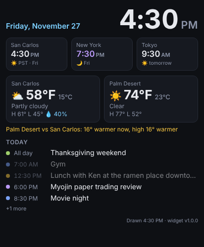

# widget

A small, glance-only version of my landing page for my **Pixel 10 home screen**.

**Live page:** https://anishimori123.github.io/landing-page/widget/

## Separate from the full page (on purpose)
Everything for the widget lives in this `widget/` folder: its own page, look, code, settings, README and CHANGELOG, and its own version number.
- A change to the **widget** only touches files in `widget/`.
- A change to the **full page** never touches `widget/`.

The only thing they share is the Google sign-in. The widget **reads** the pass the full page saved in the same browser, to show today's events. It never changes it.

## What's on it
1. 📅 **Date and local time**, big
2. 🕐 **Three small clocks:** San Carlos (PST/PDT by itself), New York, Tokyo
3. 🌤️ **Weather:** San Carlos and Palm Desert side by side (now, °F and °C, high/low, rain chance when 30% or more), plus one line comparing them
4. 🗓️ **Today's calendar events** (up to 5, then "+N more"; finished ones are dimmed)

No news, no search, no to-dos, no buttons. Tapping anywhere opens the full landing page.

## Two ways to put it on the Pixel

### A. As an icon (everything works)
1. Open the live page link above in Chrome on the phone.
2. Tap **⋮** → **Add to home screen** → **Add**.
3. Tapping the icon opens the widget page. Because it is Chrome, the Google sign-in from the full page works, so today's events show.

### B. Inside a "web page widget" app (looks like a real widget)
Android widgets can only be made by apps, so this needs a helper app from the Play Store that shows a web page inside a widget.
1. In the Play Store, search for **web widget** (one known name is **Widgetify**). Check it is free before installing; I should not pay for this.
2. Long-press an empty spot on the home screen → **Widgets** → pick the app's widget → drag it out and resize it to about half the screen.
3. When it asks for an address, paste the live page link above.
4. If it asks how often to refresh, pick **30 minutes** or **1 hour**.

**Limits of way B (honest):**
- These apps show a **picture of the page that is refreshed now and then**, not a live page. So the big time can be up to one refresh old. The small **"Drawn 4:30 PM"** line at the bottom shows when the picture was made.
- Google sign-in normally does **not** work inside such an app, so **today's events will say "Not signed in here"**. Clocks and weather still work. Never type my Google password into a widget app.

## Battery
The page is built to use very little:
- Nothing runs while it is not on screen.
- The clock has no seconds and wakes up once a minute.
- Weather is asked for at most every 30 minutes, events at most every 15 minutes; in between, saved copies are used (no internet).

In way B the battery use depends on the **refresh time set in the widget app**. Every 30 to 60 minutes is next to nothing. Every 1 to 5 minutes would cost battery, so don't pick that.
To check: after a day, open **Settings → Battery → Battery usage** and look for the widget app in the list.

## Settings
Open `widget/config.js` on GitHub → ✏️ pencil → edit → **Commit changes**. The page updates within about 10 minutes.
- `clocks`: the three small clocks
- `cities`: the two weather cities (the second is compared with the first)
- `maxEvents`: how many events to list
- `weatherMinutes`, `eventsMinutes`: how long saved data is reused

## Files
| File | What it does |
|---|---|
| `index.html` | The widget's layout |
| `widget.css` | Colors and sizes |
| `config.js` | **My widget settings.** Edit this one |
| `widget.js` | How it works |
| `preview.png` | Picture for this README (sample data) |
| `CHANGELOG.md` | Widget versions |

## Free services used
- Weather: [Open-Meteo](https://open-meteo.com/). Free, no account, no key.
- Events: Google Calendar API (free for personal use), through the full page's sign-in.
